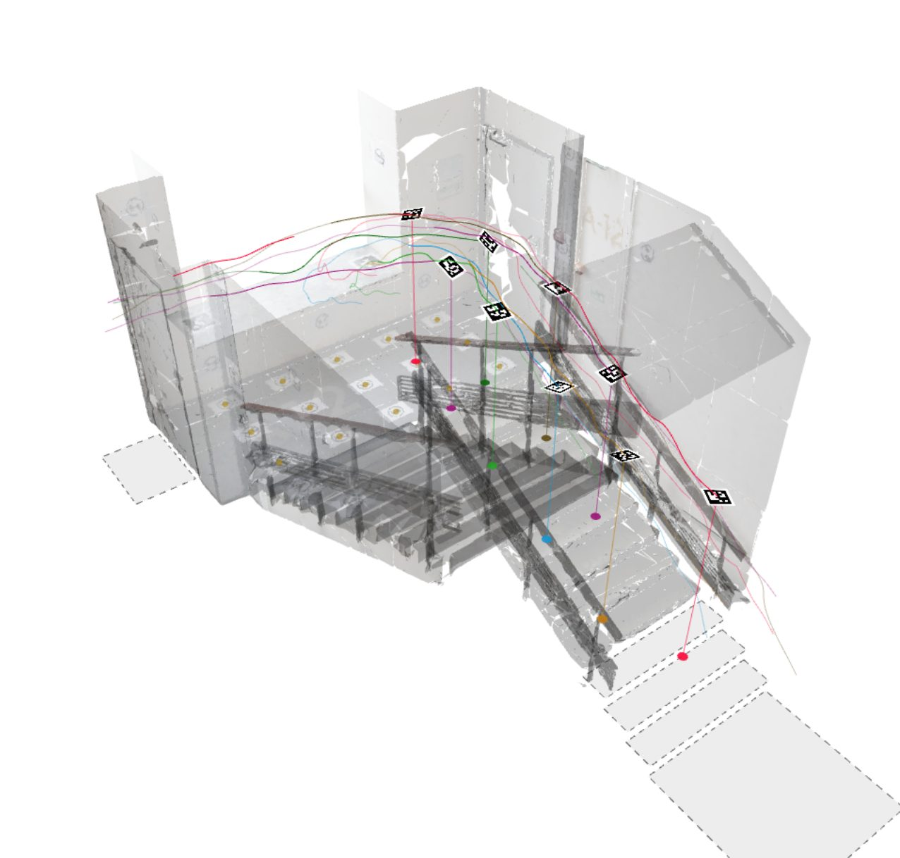

# ArUcoTrack

Metric 3-D head trajectories from overhead video of people wearing an ArUco marker on the head. The marker pose gives
the marker height in every frame, so no body height is assumed.


[](https://deekayson.github.io/arucotrack-project/)
[](https://doi.org/10.5281/zenodo.23341729)
[](https://doi.org/10.5281/zenodo.22796394)
[](LICENSE)
[](https://www.python.org/)

<p align="center">
  
</p>

## How it works

1. Detect the markers in every frame with the OpenCV ArUco detector, run at several thresholds and scales.
2. Refine the four corners from the interior edges between the marker's cells, check the refinements against a
   quality gate, and drop or resolve those that fail.
3. Estimate the marker pose with the IPPE solver for squares. The marker centre is the head point, in metres.
4. Drop the head point onto the floor plane or onto surveyed walking surfaces (stairs, landings).
5. Build one track per marker id, written raw, with short gaps filled, and smoothed.

[docs/METHOD.md](docs/METHOD.md) maps each step to the code and its parameters. The paper (see [Citation](#citation))
describes the method and compares the ArUcoTrack approach with the PeTrack approach.

## Installation

ArUcoTrack needs Python 3.12, [uv](https://docs.astral.sh/uv/) and ffmpeg (with ffprobe) on the PATH. It is tested
on Linux. macOS should work but is untested.

```bash
curl -LsSf https://astral.sh/uv/install.sh | sh     # installs uv. Then open a new shell, or run: source $HOME/.local/bin/env

sudo apt install ffmpeg                             # Debian, Ubuntu
brew install ffmpeg                                 # macOS
conda install -c conda-forge ffmpeg                 # conda

git clone https://github.com/deekayson/arucotrack.git && cd arucotrack && uv sync --frozen
uv run arucotrack --help
```

`uv sync --frozen` installs the exact locked versions, and Python 3.12 too when it is missing. No GPU is needed. If an
NVIDIA GPU and an ffmpeg with the CUVID decoders are present, video decoding uses NVDEC
([docs/ENVIRONMENT.md](docs/ENVIRONMENT.md), "Decoder").

The commands below assume `arucotrack` is on the PATH. Either activate the environment
(`source <repo>/.venv/bin/activate`) or write `uv run --project <repo> arucotrack` instead of `arucotrack`.

A CPU-only Docker image with ffmpeg included is described in [docs/ENVIRONMENT.md](docs/ENVIRONMENT.md), "Docker".

## Quick start: one clip in about 10 minutes

Download the inputs and the videos of the 26-Stairwell dataset, unzip them into one folder and compute the `tilt`
clip. Start in an empty folder outside the repository checkout:

```bash
mkdir stairwell && cd stairwell
for f in input input_videos; do
    curl -L -o $f.zip "https://zenodo.org/records/23341729/files/$f.zip?download=1" && unzip -qo $f.zip
done

arucotrack run input/configs/tilt.yaml --data-root input --out out --work work detect.threads=8
```

The download is about 0.8 GB, and the folder holds about 1.6 GB after unzipping. `--out` and `--work` override
`output.dir` and `output.work` of the configuration (the dataset's configurations name `released` and `work`).
`out/` then holds the trajectory files of the clip: `tilt.fused.txt`, `tilt.fused_interp.txt`,
`tilt.fused_smooth.txt`, `tilt.petrack.txt` and the files beside them ([Outputs](#outputs)). The `tilt` clip has 480
frames and gives 421 rows, because the marker is not seen in 59 frames. The rows hold the same positions as the
published trajectories in the record's `trajectories.zip`, which come in CSV and PeTrack layouts.

## Your own video

1. Calibration file. Calibrate the camera with OpenCV and write the result by hand into a calibration file, as
   [docs/CALIBRATION_FILE.md](docs/CALIBRATION_FILE.md) describes. [docs/CALIBRATION.md](docs/CALIBRATION.md) says
   what the calibration must provide, how to check it, and has a short Python snippet that dumps the results of
   `cv2.calibrateCamera` and `cv2.solvePnP` into the file. The camera pose comes from `cv2.solvePnP` on surveyed floor
   points (z up, floor at z = 0, metres). `arucotrack run` needs a pinhole calibration at the resolution of the
   video, and refuses a fisheye one.

2. Configuration. Copy [config.example.yaml](config.example.yaml) and set three values:

   ```yaml
   video: my_clip.mp4
   camera:
     calibration: calibration.json
   marker:
     side_m: 0.18          # the measured side of the printed black square, metres
   ```

3. Optional settings.
   - `marker.dictionary`: the ArUco dictionary of your markers, `DICT_ARUCO_MIP_36h12` by default. Only 6x6
     dictionaries work.
   - `marker.ids: [1, 2, 3]`: the marker ids in use. Other codes then cannot be decoded.
   - `floor.model`: `auto` (default) is the plane z = 0 when the calibration has a camera pose. `surfaces` with
     `floor.surfaces: surfaces.json` follows stairs and landings (file format in [docs/FORMATS.md](docs/FORMATS.md),
     "Walking surfaces").
   - `marker.border_cells`, the border constant b. The default 0.869 is for an unmeasured print. Set it for your
     camera and print with one marker at a known position. Without such a reference keep the default: what an error
     in b costs is in [docs/CALIBRATION.md](docs/CALIBRATION.md), "Border constant".

4. Run. Relative paths in the configuration are taken from `--data-root`, or from the configuration file's folder
   without it. Read a configuration you received before you run it: its `output.dir` and `output.work` can name any
   folder.

   ```bash
   arucotrack run my_config.yaml --out out --work work detect.threads=8 camera.frames=120
   ```

   Any field can be overridden with `key=value`. `camera.frames=120` checks the configuration on the first 120
   frames, which takes about 3 minutes with 4 threads. Drop it for the whole video. A run that finds no marker
   logs `no markers detected in <video>`, and its files hold headers only. That usually means a wrong
   `marker.dictionary`, or markers too small in the image.

5. Look at the outputs in `out/` (next section). With a calibration that has no camera pose, the positions are in
   the camera frame, not on the floor ([docs/FORMATS.md](docs/FORMATS.md)).

## Outputs

Per clip, `--out` holds the measured rows (`<clip>.fused.txt`), the rows with short gaps filled
(`.fused_interp.txt`), the smoothed rows (`.fused_smooth.txt`), the smoothed rows in the PeTrack layout
(`.petrack.txt`), marker orientations, a sidecar with the parameters and counts, and the resolved configuration.
[docs/FORMATS.md](docs/FORMATS.md) describes every file and column. The full layout has the timestamp `t_s` of
every frame, the head point `x/m y/m z/m` and the floor point under it, and `z - z_floor` is the marker height above
the floor. The caches in `--work` let a re-run skip the stages whose inputs did not change.

Load a PeTrack file with [PedPy](https://pedpy.readthedocs.io/):

```python
import pathlib
import pedpy

traj = pedpy.load_trajectory_from_txt(
    trajectory_file=pathlib.Path("out/tilt.petrack.txt"),
    default_unit=pedpy.TrajectoryUnit.METER,
)
print(traj.data.head())
```

## Configuration

The most used keys. All keys with their defaults are in [docs/CONFIG.md](docs/CONFIG.md).

| Key | Default | Meaning |
|---|---|---|
| `video` | required | the video file |
| `camera.calibration` | required | the calibration file |
| `marker.side_m` | required | side of the printed black square, metres |
| `marker.dictionary` | `DICT_ARUCO_MIP_36h12` | the ArUco dictionary of the markers (6x6 only) |
| `marker.border_cells` | 0.869 | border constant b, set for your camera and print |
| `marker.ids` | all | the marker ids in use |
| `floor.model` | `auto` | `auto`, `plane`, `surfaces` or `none` |
| `floor.surfaces` | none | walking-surfaces JSON for `surfaces` |
| `detect.threads` | 0 | OpenCV threads for detection, 0 = all usable cores |
| `camera.frames` | all | process only the first N frames |
| `gate.mode` | `resolve` | what happens to a refused refinement: `resolve` or `drop` |
| `output.dir`, `output.work` | `out`, `work` | trajectory files and caches (`--out` and `--work` override them) |

## Performance

Detection takes about 95 % of the run time. With 2592 x 1944 frames it processes about 1.2 frames/s with 8 threads,
so the `tilt` clip takes about 7 minutes. Peak memory is about 0.5 GB with 8 threads and grows only slowly with
the length of the video. Thread counts, Docker and GPU decoding are in
[docs/ENVIRONMENT.md](docs/ENVIRONMENT.md).

## Data

| Dataset | Content | DOI |
|---|---|---|
| 26-Stairwell | 15 clips of one overhead camera on a stairwell, with every input to compute the trajectories again (CC BY 4.0) | [10.5281/zenodo.23341729](https://doi.org/10.5281/zenodo.23341729) |
| 25-Representation | measured with the same single-camera method plus a two-camera fusion that is not part of this repository. Its videos are not published, so it cannot be computed again from here. | [10.5281/zenodo.22796394](https://doi.org/10.5281/zenodo.22796394) |

Both datasets can be viewed on the [project page](https://deekayson.github.io/arucotrack-project/).

## Citation

D. Kramný, P. Hrabák, H. Najmanová. ArUcoTrack: Pedestrian Trajectory Estimation Beyond the Fixed Vertical
Head-to-Camera Distance Assumption. Submitted to Collective Dynamics (TGF 2026).

```bibtex
@article{kramny2026arucotrack,
  title   = {{ArUcoTrack}: Pedestrian Trajectory Estimation Beyond the Fixed Vertical Head-to-Camera Distance Assumption},
  author  = {Kramn{\'y}, David and Hrab{\'a}k, Pavel and Najmanov{\'a}, Hana},
  journal = {Collective Dynamics},
  year    = {2026},
  note    = {Submitted}
}
```

To cite the software itself, use [CITATION.cff](CITATION.cff) (GitHub shows it as "Cite this repository").

## Licence

The code is under the MIT licence ([LICENSE](LICENSE)). Third-party software is listed in
[docs/THIRD_PARTY.md](docs/THIRD_PARTY.md). The datasets are published on Zenodo under their own licences.
